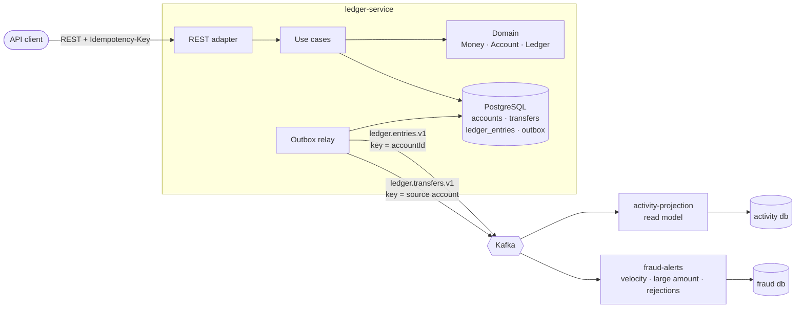

# ledger-service

A double-entry ledger for bank accounts, written in **Kotlin** with **Spring Boot 4**, **PostgreSQL** and
**Kafka**. It is a small domain built the way a production banking service would be: money is exact, every
movement is idempotent and auditable, concurrency is proven rather than assumed, and other services learn about
every change through a transactional outbox.

[](https://github.com/carlos19979/ledger-service/actions/workflows/ci.yml)

## What it guarantees, and the test that proves it

| Guarantee | Proven by |
|---|---|
| Money is never created or destroyed: all balances always sum to zero | `LedgerPropertySpec` (random operation sequences), `ConcurrencySpec` |
| No deadlocks or lost updates under parallel transfers in both directions | `ConcurrencySpec`: 600 transfers on 16 threads against real PostgreSQL |
| A retried or double-clicked request moves money once | `TransferMoneySpec`, `ConcurrencySpec` (8 parallel requests, one key) |
| History cannot be edited, and every transfer is one balanced debit + credit | `LedgerIntegritySpec`: triggers and a deferred constraint in PostgreSQL |
| Transfers keep working while Kafka is down; no event is lost | `KafkaOutageTest`: pauses the Kafka container mid-test |
| Consumers tolerate duplicates, out-of-order delivery and poison messages | `ActivityProjectionTest`, `FraudAlertsTest` |
| Layers cannot leak into each other | `ArchitectureSpec` (Konsist) |

## Architecture



A transfer is **one PostgreSQL transaction**. Inside it, the service:

1. claims the idempotency key;
2. locks both accounts in id order;
3. lets the pure domain decide (settle or reject with a typed reason);
4. writes the transfer, two balancing entries and the new balances;
5. appends the resulting events to the outbox.

The relay publishes those events to Kafka afterwards. Two independent services consume them.

| Module | Role |
|---|---|
| `ledger/domain` | Pure Kotlin: `Money`, `Account`, double-entry `Ledger.post`, sealed `TransferRejection` reasons, events |
| `ledger/application` | Use cases (`TransferMoney`, `OpenAccount`, `GetStatement`…) and ports. In-memory fakes in `testFixtures` |
| `ledger/adapters/postgres` | `JdbcClient` repositories, idempotency store, outbox store, Flyway schema |
| `ledger/adapters/rest` | Controllers, DTOs, RFC 9457 Problem Details, OpenAPI |
| `ledger/adapters/kafka` | Maps domain events onto the public contract and publishes them |
| `ledger/app` | Spring Boot application: explicit wiring, outbox relay scheduler, metrics |
| `contracts/events` | The versioned event contract, plain data classes shared with consumers |
| `consumers/activity-projection` | Per-account balance and totals, rebuildable by replaying the topic |
| `consumers/fraud-alerts` | Stateful screening rules on event time |
| `architecture-tests` | Konsist rules for the layering above |

## Run it

The whole system runs with Docker Compose. You need Docker; no local JDK or Gradle is required.

```bash
docker compose up --build          # PostgreSQL, Kafka, ledger (8080), activity (8081), fraud (8082)
docker compose --profile observability up --build   # + Prometheus on :9090
```

Swagger UI: <http://localhost:8080/swagger-ui.html>

```bash
J='Content-Type: application/json'
ALICE=$(curl -s -H "$J" -d '{"owner":"Alice","currency":"EUR"}' localhost:8080/api/v1/accounts | jq -r .id)
BOB=$(curl -s -H "$J" -d '{"owner":"Bob","currency":"EUR"}' localhost:8080/api/v1/accounts | jq -r .id)

# Deposits come from the bank's funding account
curl -s -H "$J" -H 'Idempotency-Key: seed-1' \
  -d '{"amount":{"amount":"100.00","currency":"EUR"}}' localhost:8080/api/v1/accounts/$ALICE/deposits

# Transfer; run it twice: the second answer is the same transfer, with Idempotent-Replayed: true
curl -si -H "$J" -H 'Idempotency-Key: dinner-1' \
  -d "{\"sourceAccountId\":\"$ALICE\",\"targetAccountId\":\"$BOB\",\"amount\":{\"amount\":\"40.00\",\"currency\":\"EUR\"}}" \
  localhost:8080/api/v1/transfers

curl -s localhost:8080/api/v1/accounts/$ALICE/entries | jq   # statement, newest first, cursor-paged
curl -s localhost:8081/api/v1/activity/$BOB | jq             # read model, fed by Kafka
curl -s "localhost:8082/api/v1/alerts?accountId=$ALICE" | jq # fraud alerts
```

## API

| Method | Path | Notes |
|---|---|---|
| `POST` | `/api/v1/accounts` | Open a customer account, optional `dailyDebitLimit` |
| `GET` | `/api/v1/accounts/{id}` | Balance, status, limit |
| `POST` | `/api/v1/accounts/{id}/deposits` | Requires `Idempotency-Key` |
| `POST` | `/api/v1/accounts/{id}/block`, `/unblock` | Blocked accounts can neither send nor receive |
| `GET` | `/api/v1/accounts/{id}/entries?cursor=&limit=` | Statement with opaque cursor |
| `POST` | `/api/v1/transfers` | Requires `Idempotency-Key`. `201` settled, `422` rejected (the stored transfer is in the problem body) |
| `GET` | `/api/v1/transfers/{id}` | |

Every error is an RFC 9457 Problem Details document with a stable `type`/`code`, for example `insufficient-funds`,
`daily-limit-exceeded`, `account-not-active`, `idempotency-key-reused` or `account-not-found`. Money on the wire is
a decimal string, so no client ever parses it into a float.

## Events

| Topic | Key | Event types | Payload |
|---|---|---|---|
| `ledger.entries.v1` | account id | `EntryPosted` | `EntryPostedV1`: amount and balance in minor units, `accountVersion` |
| `ledger.transfers.v1` | source account id | `TransferSettled`, `TransferRejected` | `TransferCompletedV1` |

Every record carries the headers `event-id`, `event-type` and `schema-version`. Delivery is at-least-once, so
consumers deduplicate by event id.

## Build and test

```bash
./gradlew build koverVerify     # compile (warnings are errors), detekt, ktlint, all tests, ≥80% coverage
./gradlew koverHtmlReport       # coverage report in build/reports/kover/html
```

Integration tests use Testcontainers, so they need a Docker daemon. On macOS with Colima, export:

```bash
export DOCKER_HOST=unix://$HOME/.colima/default/docker.sock
export TESTCONTAINERS_DOCKER_SOCKET_OVERRIDE=/var/run/docker.sock
```

| Layer | Style | Infrastructure |
|---|---|---|
| Domain | Kotest specs and property-based tests | none |
| Application | Kotest with in-memory ports that really roll back | none |
| PostgreSQL adapter | Kotest, a fresh migrated database per spec | Testcontainers PostgreSQL |
| REST adapter | `@WebMvcTest` with real use cases over the in-memory ports | none |
| Service end to end | `@SpringBootTest` over HTTP, Kafka outage test | Testcontainers PostgreSQL + Kafka |
| Consumers | `@SpringBootTest`, events produced to a real broker | Testcontainers PostgreSQL + Kafka |
| Architecture | Konsist | none |

## Design decisions

Each one is recorded with its context and the alternatives that were rejected:

1. [Hexagonal architecture, enforced by modules and tests](docs/adr/0001-hexagonal-multi-module.md)
2. [Money as `Long` minor units](docs/adr/0002-money-in-minor-units.md)
3. [Ordered pessimistic locking with a version check](docs/adr/0003-ordered-pessimistic-locking.md)
4. [Idempotency keys](docs/adr/0004-idempotency-keys.md)
5. [Transactional outbox with a single-publisher relay](docs/adr/0005-transactional-outbox.md)
6. [Hand-written SQL instead of JPA](docs/adr/0006-explicit-sql.md)
7. [Idempotent, order-tolerant consumers](docs/adr/0007-consumers.md)

## Deliberately out of scope

These are left out to keep the scope honest, not overlooked:

- authentication and authorisation;
- holds and reservations (two-phase transfers);
- FX between currencies;
- CDC with Debezium in place of the polling relay (see ADR 0005);
- sharding the funding account (see ADR 0003).

## Stack

Kotlin 2.3 · Java 21 · Spring Boot 4.1 (Web MVC, JDBC, Kafka, Actuator) · PostgreSQL 17 · Apache Kafka 4 ·
Flyway · Jackson 3 · Gradle 9 (Kotlin DSL, convention plugins, version catalog) · Kotest ·
Testcontainers · Konsist · detekt · ktlint · Kover · Micrometer/Prometheus · springdoc-openapi · Docker ·
GitHub Actions
